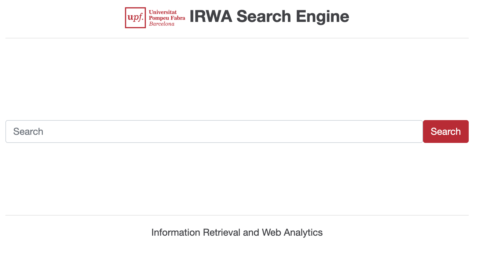

# IRWA Final Project 2026 — Fashion Products Search Engine

<table>
  <tr>
    <td style="vertical-align: top;">
      
    </td>
    <td style="vertical-align: top;">
      Search engine (and, in the last part, a RAG system with web analytics) over the fashion products dataset,
      built for the course <i>Recuperació de la Informació i Anàlisi de la Web</i> (UPF, 2026-27).
      It is implemented in Python; Part 4 uses the Flask web framework.
      <br><br>
      Group: u214405, u255290
    </td>
  </tr>
</table>

----
## Project status

| Part | Topic | Folder | Git tag |
|---|---|---|---|
| 1 | Text processing and exploratory data analysis | `project_progress/part_1/` | `IRWA-2026-part-1` |
| 2 | Indexing and evaluation | `project_progress/part_2/` | `IRWA-2026-part-2` |
| 3 | Ranking and filtering | — | — |
| 4 | RAG, user interface and web analytics | — | — |

Each part folder contains the `.ipynb` notebook with the code, the `.pdf` report and its own `README.md`
with the details of that part.

----
## Project structure

```
/
├── data                 # Dataset files (not committed, see "Data" below)
│   ├── fashion_products_dataset.json
│   └── validation_labels.csv
├── project_progress     # Our solutions for Parts 1, 2 and 3
│   ├── part_1           # Preprocessing + EDA notebook and report
│   └── part_2           # 02_indexing_evaluation.ipynb, custom_query_labels.csv and report
├── myapp                # Main application logic (Part 4)
├── templates            # HTML templates for the Flask application (Part 4)
├── static               # Static assets (images, CSS, JavaScript)
├── .env                 # Environment variables (e.g. API keys) — never commit it
├── requirements.txt     # Python package dependencies
├── web_app.py           # Main Flask application (Part 4)
└── README.md            # This file
```

----
## Setup (only the first time)

### 1. Clone the repository

```bash
cd <your preferred projects root directory>
git clone https://github.com/Mousemices/R-part1.git
cd R-part1
```

### 2. Create and activate a virtual environment

In the project root:

```bash
pip3 install virtualenv
virtualenv irwa_venv
```

Activate it:

```bash
source irwa_venv/bin/activate        # Linux / macOS
irwa_venv\Scripts\activate.bat       # Windows (cmd)
irwa_venv\Scripts\Activate.ps1       # Windows (PowerShell)
```

You should see `(irwa_venv)` in the terminal prompt.

### 3. Install the dependencies

```bash
pip install -r requirements.txt
pip install nltk pandas numpy matplotlib jupyter   # packages used by the Part 1 and Part 2 notebooks
```

The NLTK stop-word list is downloaded automatically the first time the notebooks run.

### 4. Data

Put `fashion_products_dataset.json` and `validation_labels.csv` (provided by the instructor) in the `data/`
folder at the repository root. The notebooks look for them there.

----
## How to run Part 2 (Indexing and Evaluation)

```bash
cd project_progress/part_2
jupyter notebook 02_indexing_evaluation.ipynb
```

Run all the cells in order (*Kernel → Restart & Run All*). The notebook must be started from
`project_progress/part_2/`, because it finds the data with `Path.cwd().parent.parent / "data"`.

What the notebook does, section by section:

1. **Section 0** — loads the dataset and preprocesses title, description and product details
   (lowercase, alphanumeric tokens, stop-word removal, Porter stemming), the same as in Part 1.
2. **Sections 1.1–1.2** — builds the inverted index (`create_index`) and answers conjunctive (AND) queries (`search_and`).
3. **Section 1.3** — the 5 test queries and Figure 1 (`1.3_top_title_terms.png`).
4. **Section 1.4** — TF-IDF weights and cosine-similarity ranking (`search_tfidf`, `show_top`).
5. **Section 2.1** — evaluation metrics: P@K, R@K, AP@K, F1@K, MAP, MRR and NDCG@K.
6. **Section 2.2** — metrics on `validation_labels.csv` and Figure 4 (`2.2_precision_recall_at_k.png`).
7. **Section 2.3** — metrics on our manual labels (`custom_query_labels.csv`).
8. **Section 2.4** — diagnostic cells used for the analysis of the results and of the limitations in the report.

### Options you can change

| Where | Variable / function | Effect |
|---|---|---|
| Section 1.3 | `test_queries` | the queries that are searched and evaluated |
| Section 1.4 | `show_top(query, k=10)` | search any query and show the top-k results |
| Sections 2.2 / 2.3 | `K` | cut-off used by every metric (default 10) |
| Section 2.3 | `POOL_SIZE` | how many results per query are exported for manual labelling (default 20) |

To search your own query after running the notebook:

```python
show_top("women black kurta", k=10)
```

`custom_query_labels.csv` is never overwritten: the labelling cell only creates it if it does not exist.

----
## Starting the web app (Part 4)

Before starting it, add your Groq API key (free version available at [groq.com](https://groq.com/)) and any other
configuration to the `.env` file. **Do not share or commit `.env`**: it contains secrets and is listed in `.gitignore`.

From the project root, with the virtual environment activated:

```bash
python -V          # make sure it is Python 3
python web_app.py
```

Then open [http://127.0.0.1:8088/](http://127.0.0.1:8088/) in the browser.

---- 
## Attribution

The project starts from the course template
[trokhymovych/irwa-search-engine](https://github.com/trokhymovych/irwa-search-engine),
which is adapted from [IRWA Template 2021](https://github.com/irwa-labs/search-engine-web-app).
