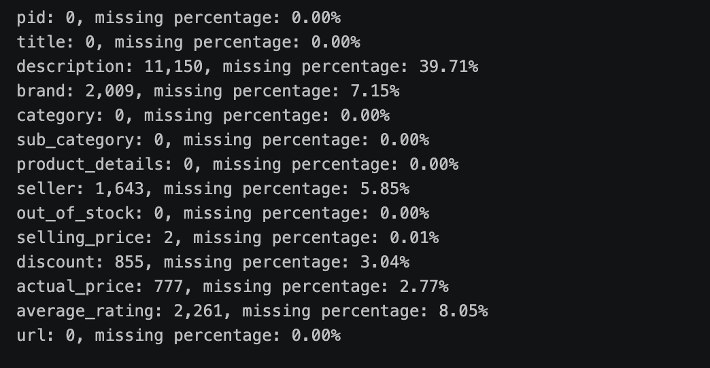
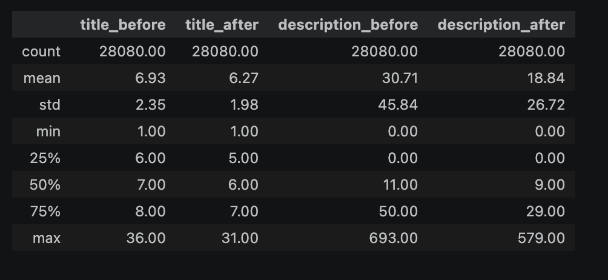
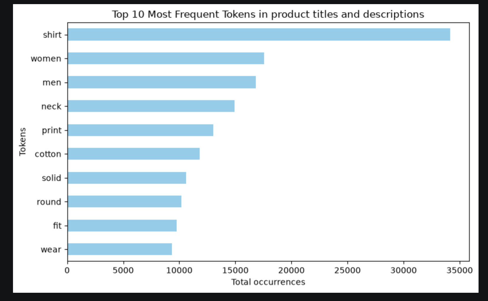
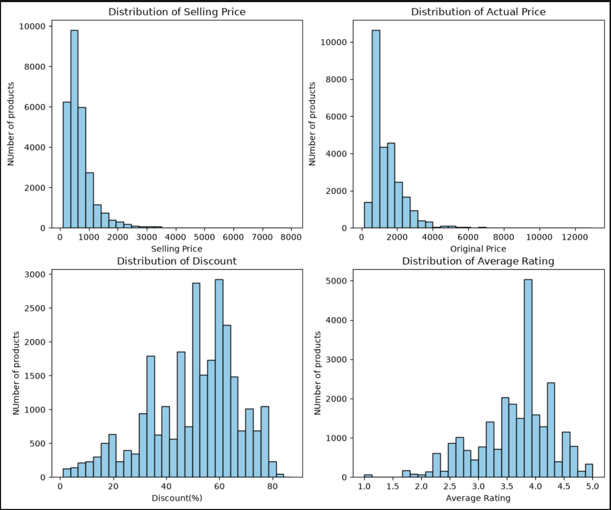
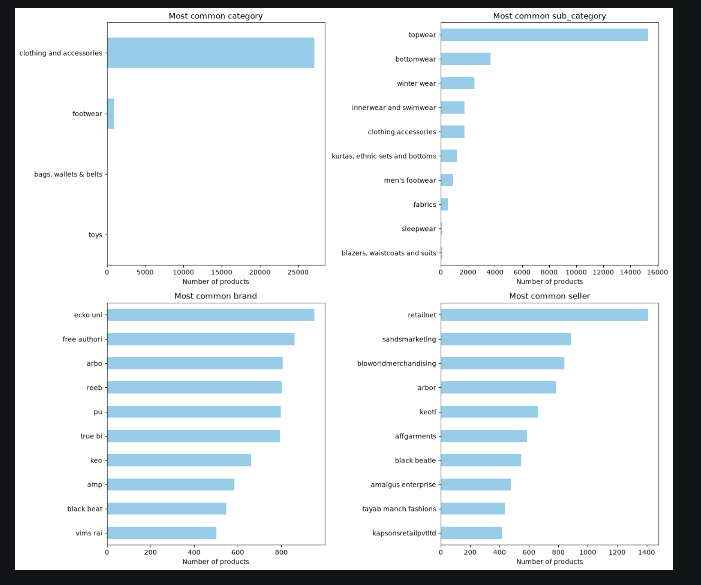
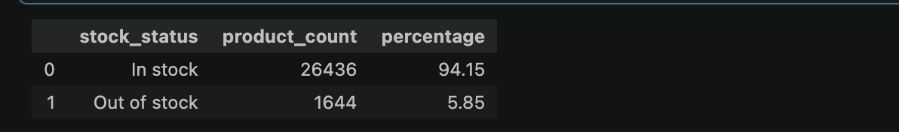
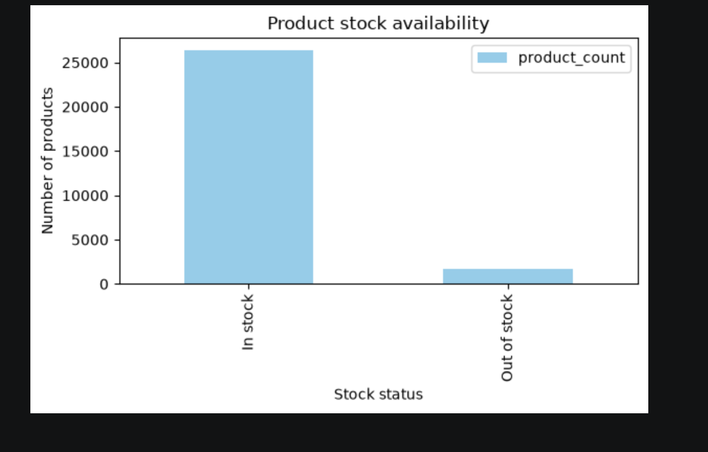

# Exploratory Data Analysis

A dataset of 28080 records.

We can observe the description is missing the most with approximately 39.7%, followed by average rating (8%) and brand (7.1%)

## Title and Description Lengths

Text length is measured as number of tokens. Same tokenizer method is applied so the comparison reclects stop-words removal. The missing description are included with length zero

The average title length decreases by approximately 9.5%, while the average description length decreases by approximately 38.6%. Description loses a larger proportion of tokens through stop-words removal.

The description lengths vary much more than titles. The mean exceeds their median, and the longest description contains 693 tokens before preprocessing, a indication a right-tailed distribution.

## Vocabulary and Frequent Tokens

After preprocessing, titles and description contains total of 705,276 tokens and vocabulary size of 4,902 tokens.
The top 3 most frequent tokens are 'shirt' with 34159 occurrences, 'women' with 17,570, and 'men' with 16,835.

## Prices, Discounts and Ratings

Both selling and original prices have right-skewed distributions. Only few products have higher prices. 

Discount is more concentrated around 45-65%, smaller or higher discounts. 

Average rating are concentrated mainly between 3 and 4.5, there is a peak point near 4.0. Lower ratings are not frequent compared to Higher ratings.

## Categories, Brands and Sellers

We can observe below the distributions of category, subcategory, brands and sellers.

Clothing and accessories contains around 27,000 products, huge amount compared to others categories. At subcategory, topwear takes around 15,000 products, followed by bottomwear and winter wear. The imbalance indacates that the dataset represents mainly clothing, topwear. Category provides limited discrimination whereas subcategory can help distinguish more specific products.

On the other hand, brand and seller are more balanced. At brand side, ecko unl has the most product records, followed by free authori. At seller level, retailnet has most records, followed by sandmarketing.

## Stock availability

This static dataset contains 26,436 in-stock products and 1,644 out-of-stock products.

# Use of AI
ChatGPT was used to explain Python concepts, functions, modules, assist with preprocessing and analysis code, issues and bugs. 

